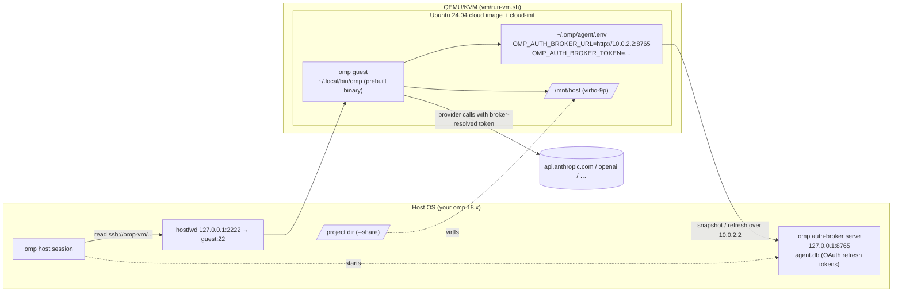

# omp-on-omp: running an isolated omp that the host omp can drive

Goal: a second, sandboxed `omp` (guest) that is fully functional — tools, LSP, Python, browser —
while the first `omp` (host) can reach it, read its files, and lend it credentials.

Three ways to get the guest, from cheapest to most isolated:

| Path            | Isolation                 | Host↔guest link while both run | GPU / drivers | Setup time | Reversible |
| --------------- | ------------------------- | ------------------------------ | ------------- | ---------- | ---------- |
| `container/`    | kernel shared, fs/pid ns  | yes (bind mount + broker)      | via `--gpus`  | ~2 min     | `docker rmi` |
| `vm/` (QEMU/KVM)| full kernel, own disk     | yes (ssh + 9p share + broker)  | none (no passthrough here) | ~5 min | delete qcow2 |
| `dual-boot/`    | bare metal                | **no** (exclusive boot)        | native        | ~1 h       | repartition |

Recommendation: **VM** for "omp on omp". It is the only option that is both fully isolated and
still live-linked to the host omp. Container if you only need a disposable sandbox. Dual-boot
only for bare-metal hardware access; it cannot host "omp drives omp" since one OS runs at a time.

## Schematic (VM path)



Credential model: the guest never stores a refresh token. It holds only the broker bearer token
and asks the host broker for short-lived access tokens (`omp://auth-broker-gateway.md`). Revoke
with `omp auth-broker token --regenerate` on the host.

## Prerequisites (host)

```sh
# Ubuntu/Debian
sudo apt install -y qemu-system qemu-utils cloud-image-utils   # qemu-system-x86_64, qemu-img, cloud-localds
sudo usermod -aG kvm "$USER" && newgrp kvm                      # /dev/kvm access
ssh-keygen -t ed25519                                           # if you have no ~/.ssh/id_ed25519.pub
```

Host omp ≥ 18.x on PATH (checked: `omp/18.8.0`). KVM is optional; without it QEMU falls back to TCG and
the guest is ~10× slower.

## VM path — step by step

```sh
cd omp-vm-setup/vm
./create-vm.sh                 # downloads Ubuntu noble cloud image, builds qcow2 overlay + cloud-init seed
./run-vm.sh --share ~/code     # boots daemonized; first boot installs omp via cloud-init (2–4 min)
./host-link.sh --broker        # registers ssh host "omp-vm" in host omp; starts broker; configures guest
```

Then:

```sh
ssh -p 2222 omp@127.0.0.1 -t '~/.local/bin/omp'                 # interactive guest omp
omp read ssh://omp-vm/home/omp/omp-install.log                  # host omp reading guest files
ssh -p 2222 omp@127.0.0.1 '~/.local/bin/omp auth-broker status' # guest sees host credentials
```

Mount the shared folder inside the guest (one-time, then add to `/etc/fstab`):

```sh
sudo mkdir -p /mnt/host && sudo mount -t 9p -o trans=virtio,version=9p2000.L hostshare /mnt/host
```

Stop: `kill "$(cat ~/.local/share/omp-vm/qemu.pid)"`. Rebuild from scratch: `./create-vm.sh` (overlay is recreated; base image cached).

### What cloud-init does (vm/cloud-init/user-data)

1. Creates user `omp` (passwordless sudo, your SSH public key, no password login).
2. Installs `curl git python3 python3-venv build-essential` (python for `omp setup python`, build tools for native addons).
3. Runs the official installer in `--binary` mode → `~/.local/bin/omp`, logs `omp --version` to `~/omp-install.log`.
4. Drops `~/.omp/agent/config.yml` with `tools.approvalMode: yolo` (disposable guest; change to `write` or `always-ask` if the VM holds anything you care about) and an `.env` template.

### Why not install from source in the guest?

The installer's `--source` path needs bun ≥ 1.3.14 and builds native addons; the prebuilt
`omp-linux-x64` binary is identical in features and boots in seconds. Pin a version with
`sh -s -- --binary --ref vX.Y.Z` if host and guest must match.

## Container path — step by step

```sh
cd omp-vm-setup/container
docker build -t omp-sandbox .
./run-container.sh --broker ~/code/myproject             # guest omp on /work, creds via host broker
ANTHROPIC_API_KEY=sk-… ./run-container.sh ~/code/myproject -p "list TODOs"   # or direct key
```

Guest state (`~/.omp`) persists in the `omp-sandbox-home` volume; `docker volume rm omp-sandbox-home` resets it.
The container reaches the host broker at the docker bridge gateway (`172.17.0.1` by default); `run-container.sh --broker`
binds the broker there, not on `127.0.0.1`. Bearer token still gates every request.

## Dual-boot path

See `dual-boot/README.md`. Summary: shared ESP, separate root ≥ 40 GB, a shared ext4 data
partition for projects, **separate** `~/.omp` per OS. No live host↔guest link exists because
the two systems never run simultaneously.

## Troubleshooting

| Symptom | Cause / fix |
| --- | --- |
| `omp: command not found` in guest | `~/.local/bin` not on PATH for non-login shells; call `~/.local/bin/omp` or re-login. |
| Installer says binary cannot start, relocation errors | musl build on Alpine; use an Ubuntu image (this setup) or `apk add libstdc++ libgcc`. |
| `omp auth-broker status` fails in guest | Host broker bound to `127.0.0.1` is reachable only through QEMU user-net alias `10.0.2.2`; with bridged networking bind the broker to the bridge IP and update `OMP_AUTH_BROKER_URL`. Token mismatch → rerun `host-link.sh --broker`. |
| cloud-init never finishes | `ssh -p 2222 omp@127.0.0.1 'cloud-init status --long; sudo tail -50 /var/log/cloud-init-output.log'`. Serial console: `~/.local/share/omp-vm/console.log`. |
| Slow guest, QEMU prints no KVM | `ls -l /dev/kvm`; add yourself to `kvm`, re-login. |
| `read ssh://omp-vm/...` fails from host omp | `omp ssh list` should show `omp-vm`; host key prompt → run `ssh -p 2222 omp@127.0.0.1 true` once. |

## Files

```
omp-vm-setup/
├── README.md                  ← this schematic
├── vm/
│   ├── create-vm.sh           image download, qcow2 overlay, cloud-init seed ISO
│   ├── run-vm.sh              QEMU/KVM launcher (ssh hostfwd, optional 9p share)
│   ├── host-link.sh           omp ssh add + optional auth-broker wiring
│   └── cloud-init/{user-data,meta-data}
├── container/
│   ├── Dockerfile             ubuntu:24.04 + omp binary installer
│   └── run-container.sh       bind-mount project, pass key or broker env
└── dual-boot/README.md        partitioning + per-OS state rules
```

References (host omp docs): `omp://cli-reference.md`, `omp://auth-broker-gateway.md`,
`omp://environment-variables.md`, `omp://config-usage.md`, `omp://providers.md`.
